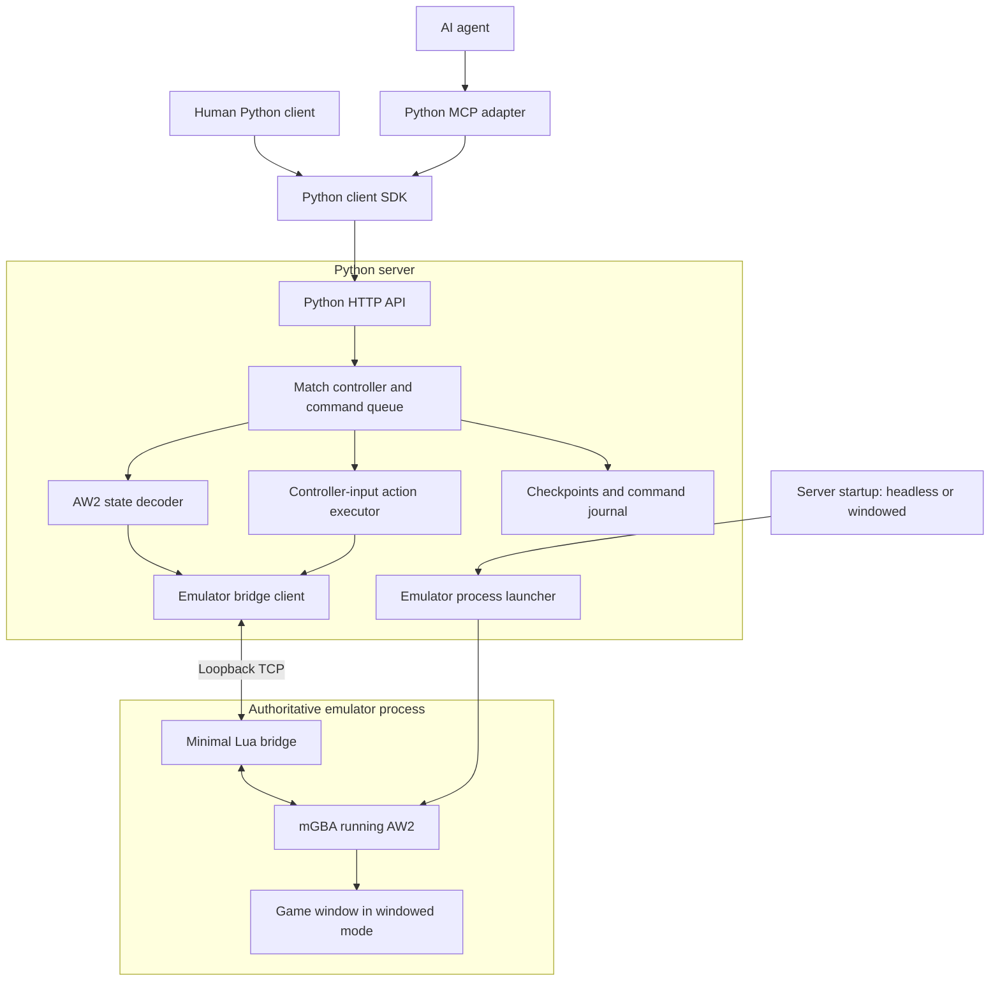

# AW2 emulator-backed multiplayer platform

## Goal and initial scope

Build a server-authoritative Advance Wars 2 platform that humans and AI agents can play through the same Python API. One mGBA process runs the authoritative game; AW2 remains responsible for rules, combat resolution, randomness, and victory conditions.

The first playable release targets local Linux development with one active match, two trusted external players, one built-in Versus map, fixed COs, and fog disabled. Both armies are externally controlled. Human players use Python scripts or an interactive Python session until a frontend is developed.

This document defines future implementation work. Creating this plan does not include implementing the milestones below.

## Technology and system architecture

- **Nix flakes:** pin development/build dependencies, mGBA source, and reproducible commands.
- **Python:** emulator lifecycle, match coordination, AW2 state decoding, action automation, HTTP server, client SDK, and MCP adapter. The HTTP API and Streamable HTTP MCP endpoint run together in one server process.
- **mGBA:** execute the original game in headless or windowed mode.
- **Lua:** expose a small set of emulator primitives through a local bridge. Keep game-specific logic in Python.
- **API libraries:** FastAPI and Pydantic for HTTP and shared models, HTTPX for the client SDK, and the official Python MCP SDK for agent access. Pin compatible versions during implementation.

Observation reads emulator RAM. Gameplay uses controller inputs. Every mutation, including debugging operations, passes through the match controller's command queue. Clients never connect directly to Lua or mGBA.

### Emulator startup modes

The Python server accepts `--emulator-mode headless|windowed`, defaulting to `headless`. The selection applies when the server launches its emulator and remains fixed for that server run.

- **Headless:** runs without a display server or visible window.
- **Windowed:** displays the authoritative match for observation and debugging. Disable competing local keyboard/controller gameplay input so server commands retain input authority.
- Both modes support the same bridge, API, frame control, screenshots, checkpoints, and gameplay behavior.
- Load the bridge automatically in both modes. Fail with a clear diagnostic if the requested mode cannot start or lacks required capabilities; never silently switch modes.
- Use a pinned mGBA source revision to build the headless and windowed frontends. Verify capabilities rather than assuming the default Nix package supplies them.

The mGBA window is emulator presentation, not the deferred frontend client.

### Emulator bridge

Expose input masks, bounded frame advancement, batched memory reads, screenshots, reset, save-state operations, and diagnostic memory writes. Normal gameplay must not depend on memory writes or internal game-routine calls.

Use a versioned request/response protocol over loopback TCP, with request IDs, explicit framing, bounded message sizes, structured errors, and base64 encoding for binary payloads initially. Handle partial reads/writes and disconnects. Restrict the bridge to the server process's local connection.

The server controls when emulation advances. Idle emulation must remain responsive without advancing the game, and batched observations must capture memory at one frame boundary. The Milestone 1 decision is to use the narrowly scoped `mgba-frame-gate.patch` with both pinned mGBA frontends. The selected unpatched executables exposed the Lua bridge listener but did not invoke its polling callback, so Lua alone could not provide responsive bridge requests or exact frame control in those builds. With the patch, headless and windowed integration checks verified idle responsiveness, non-advancing observations, and exact bounded frame budgets.

The patch polls the bridge while the frontend is idle and runs queued frame budgets only after the Lua callback returns, avoiding recursive core execution. In headless mode it replaces the normal run loop with periodic bridge polling. In Qt it polls through a timer, disables synchronization waits, and blocks UI unpause/step and local gameplay input while the gate is enabled. The change is opt-in through `AW2_MGBA_FRAME_GATE=1`; game-specific logic remains in Python.

## Interfaces and game behavior

Keep transport, ROM profiles, decoding, action execution, coordination, HTTP, SDK, and MCP in separate Python modules. Share typed request/response models across server interfaces.

### Public operations

| Area | Operations |
| --- | --- |
| Connection | Connect and inspect supported capabilities |
| Match lifecycle | Create, join a player slot, inspect, and close |
| Observation | Get structured state, screenshot, and command status |
| Initial gameplay | Move/wait, move/attack, move/capture, purchase, end turn, surrender |
| Debugging | Press buttons for a frame count, advance frames, read/write memory, reset |
| Checkpoints | Create, export/import, and restore |

Include `match_id` in interfaces even though the first implementation supports only one active match. Bind the HTTP server to loopback by default. Player-slot credentials coordinate ownership and turn-taking within the trusted-client model; this is not competitive isolation.

### Structured state

Define a versioned `GameState` with:

- Match identity, monotonic revision, emulator frame, lifecycle status, day, active player, weather, and outcome.
- Map dimensions, terrain, properties, ownership, and capture progress.
- Players, army/team, CO, funds, power meter, and active power.
- Units: identity, type, owner, position, raw/displayed health, fuel, ammo, action status, cargo relationships, and special status.
- UI phase, cursor, selected unit, and menu state required for automation.

Use zero-based map coordinates. Unit identities must survive movement and distinguish replacements when internal slots are reused. Associate identity bookkeeping with checkpoints.

Introduce fields only after validating their decoding. Represent unknown/unavailable values explicitly rather than guessing. Detect title screens, menus, and transitions before interpreting RAM as a battle. Publish coherent observations at command boundaries; reads do not advance the emulator.

### Commands and action execution

Combine movement and its final action into a single high-level transaction. Require an explicit movement path, including an empty path for a stationary action. This preserves route choice without introducing strategy or legal-move enumeration.

An action request identifies the match, player, unit or property, action parameters, expected state revision, and unique request ID. The server returns a command ID; the SDK offers convenience methods that wait for completion.

- Serialize commands and check ownership, turn, and revision when execution begins.
- Deduplicate request IDs so network retries cannot execute an action twice.
- Validate request shape and obvious state constraints; let AW2 resolve action legality and results.
- Navigate menus with a state machine: verify preconditions, supply input, wait for recognized transitions, and verify postconditions.
- Use frame budgets and state predicates instead of wall-clock sleeps. Also enforce a wall-clock watchdog for a hung emulator.
- Return completed, rejected, rolled-back, or recovery-required results, including the resulting revision and useful diagnostics.

Save a recovery checkpoint before each high-level action. Restore it after unexpected UI state, failed postconditions, or timeout. If recovery fails, stop accepting mutations until explicitly restored. Low-level mutations increment revisions, invalidate cached UI assumptions, and require a recognized state before high-level execution resumes.

### Persistence and MCP

A checkpoint includes emulator state, save RAM, ROM checksum, emulator build identity, decoder version, and Python identity metadata. Verify that save-state flags include the required save RAM. Restoration creates a fresh monotonic revision so stale requests cannot become valid again.

Persist checkpoints and a command journal locally. On restart, restore the last committed checkpoint and reconcile unfinished commands without silently replaying them. Treat emulator snapshots as build-specific artifacts, not portable save formats.

Provide an MCP adapter that calls the Python SDK and is hosted at `/mcp` alongside the HTTP API. Expose typed gameplay, observation, lifecycle, and checkpoint tools, with raw operations clearly named as debug tools. The adapter must not duplicate game logic or own another emulator. Support state and screenshot observation; defer strategy, legal-move helpers, and speculative rollouts.

## Implementation roadmap

### 1. Reproducible emulator-control spike

**Dependencies:** none; this is the integration feasibility gate.

**Deliverables:** Nix flake and lock, Python package/dependency lock, pinned mGBA builds, mode-selecting launcher, minimal Lua bridge, and development/check commands.

**Acceptance criteria:**

- Both startup modes load the ROM and bridge without manual interaction.
- Headless startup works without a display; windowed startup presents the game and prevents competing local input.
- Python can hold/release buttons, advance exact frame counts, read a coherent memory batch, capture screenshots, and save/restore state.
- Commands remain responsive while emulation is idle; observation does not advance frames.
- Bridge disconnects, emulator failures, invalid modes, and missing display/capabilities produce clear errors.
- Checkpoint restoration reproduces the observed state, and the emulator shuts down cleanly.

The required frontend frame-gate patch and its rationale are recorded in the Emulator bridge section above.

### 2. Targeted AW2 reverse engineering

**Dependencies:** reliable emulator primitives from milestone 1.

**Deliverables:** one checksum-verified US retail ROM profile, memory-dump/diff/watch tools, documented memory layouts, and a Python state decoder.

Use existing decompilation/disassembly projects as leads; verify adopted addresses against the unmodified supported ROM. Reject unsupported ROM images. Record field sizes, signedness, pointer handling, evidence, and confidence. Start with battle lifecycle, map, players, units, turn, and UI state rather than attempting a full decompilation.

**Acceptance criteria:** structured snapshots match manually inspected states before and after movement, combat damage, purchasing, capture, and turn changes. Title screens and transitional states are recognized safely. Observations agree between emulator modes for the same checkpoint.

**Status:** accepted for the documented checksum-verified US revision-0 Versus subset. The [Milestone 2 acceptance audit](MILESTONE-2.org) links each deliverable and criterion to implementation, tests, and recorded emulator evidence, and preserves the remaining research limits and Milestone 3 integration work.

### 3. First playable server/client release

**Dependencies:** decoded battle/UI state from milestone 2.

The implementation checklist is tracked in [MILESTONE-3.org](MILESTONE-3.org).
Begin with client architecture design for web, Linux/macOS/Windows desktop,
and Android/iOS clients, including Nix development/packaging and a NixOS
compatibility prototype. Full frontend implementation remains deferred; the
first playable release uses the Python SDK and example scripts.

Nix/NixOS is the primary development and testing path and receives the most
frequent verification. Prioritize reproducible Nix environments, Linux client
packaging, and NixOS runtime checks when selecting client technologies. Web,
macOS, Windows, Android, and iOS remain client design targets; record their
verification coverage and native toolchain requirements explicitly before
claiming support.

**Deliverables:** command queue, initial actions, checkpoint recovery, HTTP API, Python SDK, persistent journal, and two-client example scripts.

Automate cold-boot menu navigation into the fixed two-player Versus configuration. Both players are controlled through the server. Implement movement/wait, attack, capture, purchase, end turn, and surrender before expanding action coverage.

**Acceptance criteria:** two Python clients can start, play, finish, save, and resume a match in either emulator mode. Illegal or stale commands fail cleanly; retries do not duplicate actions; unexpected menus and timeouts recover or explicitly stop the match. Restart restores the last committed checkpoint.

### 4. MCP access

**Dependencies:** usable Python SDK from milestone 3.

**Deliverables:** Streamable HTTP MCP endpoint hosted by the API server, typed tools, connection examples, and documentation for coordinates, turn handling, failures, and debugging.

**Acceptance criteria:** human-versus-agent and agent-versus-agent clients can inspect a match and complete turns in both modes through the same server. Agents need no emulator-specific knowledge to use high-level actions.

### 5. Expand local Versus coverage

**Dependencies:** stable playable slice and MCP adapter.

Add features in this order:

1. CO power/super power, joining units, transport loading/unloading, resupplying, diving/surfacing, and missile silos.
2. Map/CO selection, configurable match rules, weather, and two to four players/teams.
3. Fog-enabled matches with explicitly omniscient observations for trusted research clients.

**Acceptance criteria:** each feature has verified decoding, action execution, error/recovery scenarios, and capability advertisement. Clients can distinguish unsupported features from illegal actions.

Defer frontend client development, public hosting/accounts, simultaneous matches, competitive visibility filtering, custom maps, campaign modes, link-cable emulation, built-in strategy, legal-move enumeration, and forked rollouts.

## Validation and research uncertainties

| Area | Scenarios |
| --- | --- |
| Emulator modes | Both launch paths, automatic bridge loading, idle responsiveness, exact frame advancement, input authority, screenshot capture, shutdown |
| Bridge | Fragmented messages, partial writes, disconnects, malformed/bounded requests, timeout handling |
| State decoder | Damage, destruction and slot reuse, cargo, capture progress, funds, powers, weather, lifecycle transitions |
| Action execution | Success, rejection, stale revision, duplicate request, simultaneous submissions, unexpected menu, timeout, rollback failure |
| Persistence | Complete checkpoint round trip, save RAM restoration, build/ROM mismatch, restart with unfinished command |
| End to end | Cold boot, create/join, purchase/move/attack/capture, turn change, victory, save/restore/resume, HTTP/MCP parity |

From the same checkpoint and recorded frame inputs, compare decoded state hashes under the same pinned emulator build. Exercise both frontends rather than assuming identical integration behavior. Run ROM-independent checks by default; run AW2 integration checks when a local ROM is configured. Keep ROMs and generated save states outside source control and the Nix store.

Uncertainties to resolve during the milestones:

- Can the selected mGBA build provide responsive, exact frame gating through Lua alone in both frontends?
- Can windowed local input be disabled without interfering with scripted inputs?
- Which RAM structures and UI transitions are stable enough for reliable decoding and automation?
- Which snapshot flags and Python metadata are required for complete recovery?
- Can replayed frame inputs reproduce the same game results under the pinned build?

These are experimental questions, not claimed completed capabilities. The first milestone must prove the integration primitives before substantial game-specific automation proceeds.

## Research sources

- [mGBA scripting API](https://mgba.io/docs/scripting.html): documented memory reads, inputs, frame execution, screenshots, save states, and sockets. Validate behavior against the pinned build.
- [mGBA headless frontend source](https://github.com/mgba-emu/mgba/blob/master/src/platform/headless-main.c): upstream headless startup scripting and scripting/socket attachment.
- [mGBA build configuration](https://github.com/mgba-emu/mgba/blob/master/CMakeLists.txt): frontend and scripting build options.
- [mGBA changes](https://github.com/mgba-emu/mgba/blob/master/CHANGES): development features and release context; do not equate upstream availability with packaged support.
- [Nixpkgs mGBA package](https://github.com/NixOS/nixpkgs/blob/nixos-unstable/pkgs/by-name/mg/mgba/package.nix): packaging reference; pin the actual package/source used by this project.
- [AW2 decompilation](https://github.com/Eebit/aw2bhr): initial reverse-engineering reference, not a complete verified state API.
- [AW2 Infinite COs](https://github.com/XenesisXenon/AW2-InfiniteCOs): disassembly/modding reference; verify findings against the original supported ROM.
- [Official Python MCP SDK](https://github.com/modelcontextprotocol/python-sdk): implementation and compatibility reference for the agent adapter.
